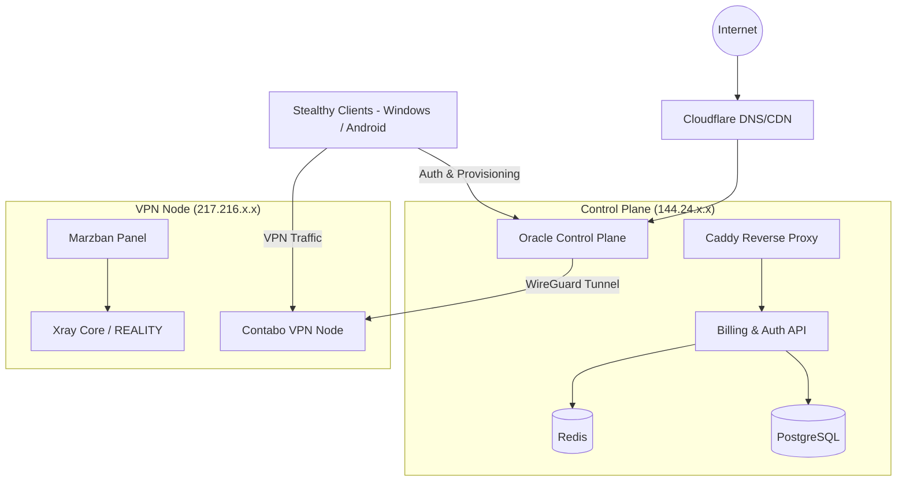

# Stealthy Architecture (Formerly RealityTunnel)

This document is the canonical architecture guide for the Stealthy VPN project.

## High-Level Topology

## Component Roles

### Oracle Control Plane (Control Plane)
- Handles user registration, master token issuance, session refresh, and API requests.
- Contains the Billing API and User Database (PostgreSQL).
- Securely protected behind Cloudflare (WAF).
- Communicates with the VPN Nodes via an internal WireGuard tunnel to provision Xray configurations on Marzban.

### Contabo VPN Node (Data Plane)
- Exposed to the raw Internet to accept incoming Xray/REALITY connections.
- Contains Marzban to handle Xray traffic provisioning and limits.
- No direct database access or sensitive customer data resides here; Marzban operates purely on provisioned user configurations from Oracle.

## Trust Relationships
- **Client ↔ Oracle**: The client trusts Oracle via TLS (Cloudflare). Oracle trusts the client through the presentation of Master Tokens and subsequent short-lived JWTs.
- **Oracle ↔ Contabo**: Oracle provisions Contabo exclusively via a private WireGuard tunnel. Contabo does NOT accept provisioning requests directly from the public Internet.
- **Client ↔ Contabo**: Client trusts Contabo based on the `public_key` and server IP provisioned by Oracle inside the signed License Blob. Contabo trusts the client if it presents a valid VLESS UUID.

## Key Flows

### Provisioning Flow
1. User subscribes on the website / Billing API.
2. Oracle generates a unique VLESS UUID and retrieves the REALITY public key for the assigned VPN node.
3. Oracle dispatches an API request over the WireGuard tunnel to Marzban on Contabo to provision the new user.
4. Marzban injects the user into the running Xray instance.

### VPN Login Flow
1. Client presents the Master Token to Oracle (`POST /api/auth/token`).
2. Oracle validates the Master Token and returns a short-lived `AccessToken` and `RefreshToken`.
3. Client uses the `AccessToken` to request the user's License Blob (`GET /api/provisioning/profile`).
4. Oracle generates a License Blob containing the VPN server IP, VLESS UUID, and REALITY Public Key, signs it with its Ed25519 private key, and returns it to the client.
5. Client verifies the signature locally. If valid, it connects to the VPN Node (Contabo) using Xray.

### JWT Flow
- Master Tokens are long-lived and represent physical account ownership. They are stored securely using DPAPI / EncryptedSharedPreferences and zeroed out from memory.
- Access Tokens (JWT) are valid for 1 hour.
- Refresh Tokens are used to obtain new Access Tokens.
- If a replay attack or token compromise is detected on the backend, the Refresh Token is revoked. The client will transition to the `ReplayDetected` state, evict all local tokens, and force the user to log in again.

### Billing Flow
- Orchestrated entirely on Oracle.
- If a user's subscription expires, Oracle suspends the user via Marzban over WireGuard.
- The client periodically checks its Subscription Info via Oracle. If expired, it displays a "Subscription Expired" notice and prevents connection attempts.

## Failure Scenarios

1. **Oracle Goes Down**: 
   - Clients that already have a valid License Blob and are within the 72-hour grace period can continue connecting directly to Contabo.
   - New logins or provisioning fails.
2. **Contabo Goes Down**: 
   - VPN connections fail. Oracle remains up. 
   - The client will see a "Failed" status and enter an AutoRetry loop with exponential backoff until Contabo recovers.
3. **WireGuard Tunnel Drops**: 
   - Oracle cannot provision new users on Contabo. Existing users can still connect to Contabo.
4. **Cloudflare Outage**:
   - Oracle API is unreachable. Offline grace period takes over for clients with cached signed profiles.
